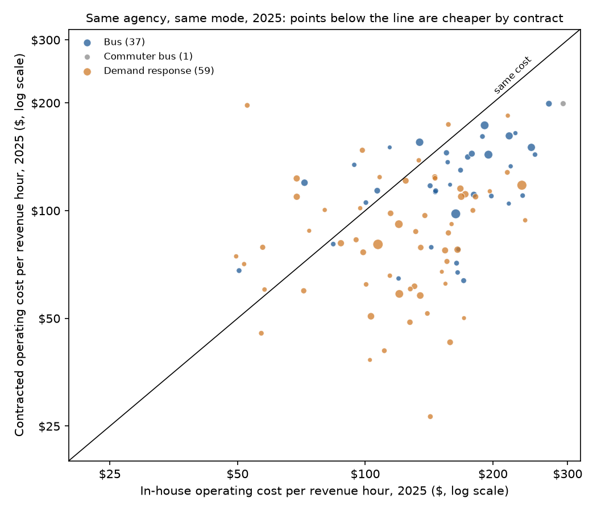
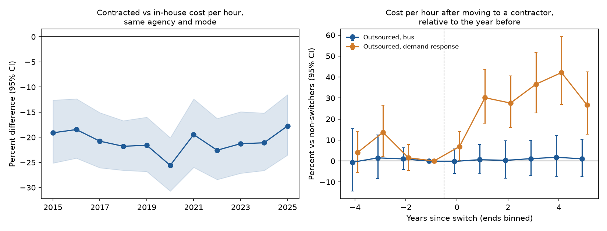

# Bidding for the Bus

### In 1968, Harold Demsetz asked why a utility that can only have one supplier needs a regulator, when the right to be that supplier could be put up for auction. I asked again using the bus and paratransit routes American transit agencies put out to bid.

---

In 2025 the Los Angeles County Metropolitan Transportation Authority ran 6.4 million hours of bus service with its own drivers, mechanics and dispatchers, and the bill came to $1.57 billion, or $246 for every hour a bus was out carrying passengers. For another 417,000 hours, Metro paid private operators, led by MV Transportation, under competitively bid contracts. Those hours cost $150 each. Down the coast, San Diego's Metropolitan Transit System runs more of its bus hours through contractors, led by Transdev, than through its own garages, at $98 an hour against $163 in-house. In Houston, Metro's contracted buses cost $143 an hour and its own cost $195.

A city bus network is about as close to a natural monopoly as anything outside the pipes and wires. Two companies running competing buses down the same street at the same time, each half empty, would waste money, so one operator gets each route. The old economics textbook answer was that a sole supplier will charge a monopoly price unless the state regulates it or runs it. A transit agency that hands a route to a private contractor seems to be trying something else, letting the operators compete for the right to run the route and then leaving the winner alone to run it, which is the arrangement Harold Demsetz argued for in 1968.

---

## Two measures and one formula

The basic unit of transit output is the vehicle revenue hour, one hour of one bus (or paratransit van) in service and available to riders. The National Transit Database, which agencies receiving federal transit formula funds report to, records operating expense and revenue hours for every agency, every mode and both types of service, directly operated and purchased. For agency $`a`$, mode $`m`$, type of service $`j`$ (in-house or contracted) and year $`t`$, with operating expense $`E_{amjt}`$ and revenue hours $`H_{amjt}`$, the cost per hour is

```math
c_{amjt} = \frac{E_{amjt}}{H_{amjt}}
```

Los Angeles Metro's in-house bus service in 2025 is the worked example.

```math
c_{\text{LA Metro, bus, in-house}} = \frac{\$1{,}572{,}456{,}883}{6{,}382{,}913\ \text{hours}} = \$246.35\ \text{per hour}
```

Every comparison below is run in logarithms, so a coefficient $`\beta`$ on "contracted" is a proportional difference. It converts to a percent as

```math
\%\Delta = 100\,\bigl(e^{\beta} - 1\bigr), \qquad \text{so}\quad \beta = -0.233 \;\Rightarrow\; 100\,(e^{-0.233} - 1) = -20.8\%
```

The third piece is the arithmetic of bidding itself. Suppose $`N`$ firms bid to run a route and each firm's cost per hour is an independent draw, uniformly distributed between a best possible cost $`c_L`$ and a worst $`c_H`$. If the firms keep undercutting one another until only one is left, the lowest-cost firm wins at the price where the runner-up drops out, which is the runner-up's own cost. The winning price is then the second-lowest of the $`N`$ costs, $`c_{(2)}`$, and its average position is

```math
\mathbb{E}[\,p \mid N\,] = \mathbb{E}\bigl[c_{(2)}\bigr] = c_L + \frac{2}{N+1}\,\bigl(c_H - c_L\bigr)
```

The fraction $`2/(N+1)`$ is how far up the cost range the price sits. It falls quickly as bidders are added.

| Bidders | Expected price, as a share of the way from best cost to worst cost |
|---|---|
| 2 | 0.667 |
| 5 | 0.333 |
| 20 | 0.095 |

With one bidder there is no second cost to discipline the price, and the bidder asks whatever the buyer will pay.

---

## Harold Demsetz's question

Harold Demsetz was teaching at the University of Chicago's Graduate School of Business when he wrote "Why Regulate Utilities?" for the April 1968 *Journal of Law and Economics*. He had come from the University of Michigan and from a first stint at UCLA, and in 1971 he went back to UCLA for good. He was already known for a 1967 paper on property rights, and he would later coin the phrase "nirvana fallacy" for the habit of comparing a real market with an imaginary perfect government. He died in January 2019. In a tribute that month, the Chicago economist Sam Peltzman picked out the 1968 paper and the idea that now carries his name, the Demsetz auction, and gave as one example the double-decker buses of London, once run by the government and now run by private operators that bid for the subsidy to run them.

The paper is eleven pages long and contains no regressions. Regulation had lately been criticized as ineffective, most pointedly in George Stigler and Claire Friedland's 1962 study of electricity prices, but Demsetz observed that the basic argument for regulating utilities had gone unchallenged. His target was a step in the textbook argument he thought had never been justified. Economies of scale explain why only one firm ends up producing, he agreed, but nothing in them explains why that firm's price must be a monopoly price. Rivals can compete before production begins, by bidding for the contract to serve the whole market. What decides how competitive the price is, he wrote, is the number of bidders and the cost of colluding, not the number of firms left producing once the contract is signed. He credited the Victorian reformer Edwin Chadwick, who in 1859 had distinguished competition "for the field" from competition "within the field."

The argument can be put in a few lines. Assume a city invites bids for the exclusive right to serve all demand $`Q(p)`$ at a price $`p`$ the bidder names, that at least two firms can buy the inputs on open markets, that their average cost $`AC_i(q)`$ falls with output, and that they cannot collude. The lowest price wins. Write $`AC_{(1)}`$ and $`AC_{(2)}`$ for the lowest and second-lowest average costs among the bidders.

```math
\begin{aligned}
\pi_i(p) &= \bigl(p - AC_i(Q(p))\bigr)\,Q(p) \\
p > AC_{(2)} &\;\Rightarrow\; \text{the runner-up can undercut at a profit} \\
p < AC_{(1)} &\;\Rightarrow\; \pi_{(1)}(p) < 0 \\
\therefore\quad p^{*} &= AC_{(2)}\bigl(Q(p^{*})\bigr) \\
AC_{(1)} = AC_{(2)} &\;\Rightarrow\; p^{*} = AC\bigl(Q(p^{*})\bigr)
\end{aligned}
```

Here $`\pi_i`$ is bidder $`i`$'s profit and each average cost is evaluated at the quantity $`Q(p)`$ demanded at the named price. The franchise goes to one firm, as scale economies require, but the price it wins at is pinned to average cost by the next-best bidder rather than set by the elasticity of demand $`\varepsilon`$, as in the unregulated monopolist's markup rule $`(p^{m} - MC)/p^{m} = 1/|\varepsilon|`$, where $`p^{m}`$ is the monopoly price and $`MC`$ marginal cost. That markup is the gap a regulator was supposed to close.

The only facts in the paper come from history. Quoting Burton Behling's 1938 study of public utilities, Demsetz pointed out that forty-five electric light companies held the legal right to operate in Chicago in 1907, and that a special report of 1902 found 1,002 of the 1,051 American cities over 4,000 people had telephone service, with Bell holding a monopoly in 414, independent companies in 137 and duplicated service in the other 451. He used these counts to argue that utilities had once been rivalrous and that regulation replaced the rivalry rather than following from its absence.

The strongest objection came eight years later from Oliver Williamson, who would share the 2009 Nobel Memorial Prize in Economic Sciences. In "Franchise Bidding for Natural Monopolies," in the *Bell Journal of Economics* in 1976, he took the cable television franchise in Oakland, California, as a case study and argued that the auction only works at the moment it is held. Contracts for long-lived, complex services cannot foresee everything, so the winner and the city end up renegotiating. The winner learns the job and the city's quirks, and at renewal the losing bidders face an incumbent with an advantage they cannot match, so the second auction is weaker than the first. Franchise bidding, on this view, slides back into something that looks like regulation without the regulator's tools. Demsetz's view is that rivalry for the contract disciplines price; Williamson's is that the discipline fades once the contract is signed. Neither paper tested its claim statistically.

---

## How I tested it

American transit gives both claims a large public test. The National Transit Database's time series for 2015 to 2025 reports operating expense and revenue hours for each agency, mode and type of service. I kept the three road modes that agencies both run themselves and buy, which are fixed-route bus, commuter bus and demand response (paratransit and dial-a-ride vans). I dropped rows with under 2,000 revenue hours, about one vehicle's worth, converted everything to 2025 dollars with the consumer price index and trimmed the top and bottom 1% of cost per hour within each mode to guard against reporting errors. That leaves 31,746 agency-mode-service-years. The 2025 contract file, the NTD's form B-30, adds the contractor's name and whether each of 1,085 contracts was competitively bid, negotiated or subsidized.

Demsetz's prediction is that the bid price lands near the cost of an efficient operator, while a sole supplier answering to no bidder does not. The cleanest version compares contracted with in-house hours inside the same agency and mode, so that local wages, traffic and the agency's own accounting habits cancel out. For agency-mode $`am`$, type of service $`j`$ and year $`t`$, with $`PT_{j}`$ equal to one for purchased service,

```math
\ln c_{amjt} = \alpha_{am} + \lambda_t + \beta\, PT_{j} + \varepsilon_{amjt}, \qquad H_0:\ \beta = 0
```

where $`\alpha_{am}`$ is an agency-by-mode fixed effect and $`\lambda_t`$ a year effect. Standard errors are clustered by agency. Two further tests go after the mechanism. The first splits 2025 contracted service by how it was let, with $`BID_{amj}`$ marking contracted service at agency-modes where at least half the contract dollars were competitively bid and $`NEG_{amj}`$ the rest of the contracted service. The second relates the cost of competitively bid service to $`F_{s}`$, the number of distinct contractor firms holding bus or paratransit contracts in the agency's state, which is the closest public stand-in for the number of bidders.

```math
\begin{aligned}
\ln c_{amj} &= \alpha_{am} + \beta_C\, BID_{amj} + \beta_N\, NEG_{amj} + \varepsilon_{amj} && \text{(2025, both kinds)} \\
\ln c_{am} &= \gamma_m + \delta \ln F_{s(a)} + X_{am}'\theta + u_{am}, \quad H_0:\ \delta = 0 && \text{(2025, competitively bid only)}
\end{aligned}
```

The controls $`X_{am}`$ are log revenue hours, log urbanized-area population, a rural indicator and the share of contract dollars where the agency supplies the vehicles; this regression has one row per competitively bid agency-mode and is clustered by state. The first is clustered by agency. Demsetz's argument predicts $`\delta < 0`$. I grouped contractors by parent company, folding First Transit into Transdev, which bought it in March 2023.

---

## Contracted service costs about a fifth less inside the same agency

Across 371 agency-modes at 289 agencies that ran the same mode both ways at some point between 2015 and 2025, contracted hours cost less.

```math
\hat{\beta} = -0.233\ (0.029),\quad 95\%\ \text{CI}\ [-0.290,\ -0.177],\quad N = 4{,}676,\quad \%\Delta = -20.8\%\ [-25.2\%,\ -16.2\%]
```

The gap holds in each mode separately, at 23.7% for bus, 18.8% for demand response and 16.2% for commuter bus, and widens to 30.9% when each row is weighted by its revenue hours, so the gap is larger at the agencies that run the most hours. In 2025 alone, 76 of the 97 agency-modes running both kinds of service bought their contracted hours for less than they ran their own, with a median difference of 27.1%.

| Agency | Mode | In-house cost per hour | Contracted cost per hour | Largest contractor | Difference |
|---|---|---|---|---|---|
| Los Angeles Metro | Bus | $246 | $150 | MV Transportation | −39% |
| NJ Transit | Bus | $218 | $162 | Academy Lines | −26% |
| King County Metro (Seattle) | Bus | $271 | $199 | Hopelink | −27% |
| Houston Metro | Bus | $195 | $143 | Transdev | −27% |
| Orange County Transportation Authority | Bus | $191 | $173 | Keolis | −9% |
| San Diego MTS | Bus | $163 | $98 | Transdev | −40% |
| Pace (suburban Chicago) | Bus | $155 | $145 | MV Transportation | −7% |
| Houston Metro | Demand response | $107 | $80 | MV Transportation | −25% |
| Maryland Transit Administration | Demand response | $234 | $118 | Transdev | −50% |
| VIA Metropolitan Transit (San Antonio) | Demand response | $120 | $59 | MV Transportation | −51% |



Taken at face value this is Demsetz's result, and a large one. On Los Angeles Metro's 417,000 contracted bus hours, a $96 difference per hour is about $40 million a year.

The cross-section is less striking. Comparing all 2,714 in-house and contracted services at 2,622 agency-modes in 2025, including agencies that only do one or the other, with mode and state effects and controls for size, competitively bid service is 10.7% cheaper (95% CI 2.9% to 17.8%). That comparison sets agencies that contract everything against agencies that contract nothing, which differ in many ways besides how they buy service, so the within-agency comparison is the sharper one.

---

## The number of bidders does not explain the saving

If bidding is what pulls price down to cost, competitively bid contracts should beat negotiated ones, and contracts let where many operators are active should beat those let where few are. Neither pattern appears in the data.

```math
\begin{aligned}
\hat{\beta}_C &= -0.337\ (0.071), \qquad \hat{\beta}_N = -0.407\ (0.264), \qquad N = 184 \\
\hat{\delta} &= 0.048\ (0.032),\quad 95\%\ \text{CI}\ [-0.014,\ 0.109],\quad N = 611
\end{aligned}
```

Inside the same agency in 2025, competitively bid service ran 28.6% below in-house and negotiated service 33.5% below, a difference the data cannot tell from zero, though only 10 negotiated agency-modes sit in that comparison. Across 611 competitively bid agency-modes in 48 states, the District of Columbia and Puerto Rico, more contractor firms in the state go with slightly higher contract costs, not lower ones, and the estimate is not significant.

| Contractor firms active in the state | Competitively bid agency-modes | Median cost per hour |
|---|---|---|
| 1 to 3 | 36 | $108 |
| 4 to 8 | 63 | $109 |
| 9 to 20 | 165 | $113 |
| 21 or more | 347 | $119 |

The firms themselves are few at the top. Of $8.77 billion in competitively bid bus and paratransit contracts reported for 2025, three groups hold 56.6%.

| Contractor group | Share of competitively bid contract dollars | Agencies served |
|---|---|---|
| Transdev (including First Transit) | 34.8% | 104 |
| MV Transportation | 13.1% | 78 |
| Keolis | 8.7% | 8 |
| National Express | 3.9% | 13 |
| RATP Dev | 3.6% | 21 |

The national Herfindahl index on these shares is 1,520, and 315 contractor groups appear in total, most of them local firms holding a single contract. A count of firms by state is a rough proxy for who actually bid on a given contract, and the NTD does not record bids. What the data rules out is a strong, visible link between how crowded a state's contractor market is and what agencies pay.

---

## Switching to a contractor did not make bus service cheaper

Williamson's objection predicts that the saving from bidding shrinks over the life of contracts. Year by year, inside agencies running both kinds of service, the gap has not moved. It was 19.1% in 2015, 21.6% in 2019, 25.6% in 2020 and 17.7% in 2025, and the linear trend is flat.

```math
\hat{\beta}_{\text{trend}} = -0.0003\ (0.0043)\ \text{per year},\qquad 95\%\ \text{CI}\ [-0.009,\ 0.008]
```

That would seem to settle the matter for Demsetz, but a fixed gap between two kinds of hours is not the same as a saving from contracting. The sharper test follows agencies that changed. Between 2017 and 2024, 91 agency-modes switched entirely from running a service themselves to buying it, and 32 went the other way. For each switcher I measured cost per hour against agencies in the same mode and year that never switched, and estimated

```math
r_{amt} = \alpha_{am} + \sum_{k \neq -1} \theta_k\, \mathbf{1}\bigl[t - T_{am} = k\bigr] + u_{amt}
```

where $`r_{amt}`$ is the switcher's log cost per hour minus the non-switchers' average for that mode and year, $`T_{am}`$ is the first year under the new arrangement, and the year before the switch is the reference. Errors are clustered by agency. The difference between the average of the years after the switch and the average of the years before is

```math
\begin{aligned}
\text{bus:}\quad \bar{\theta}_{\text{after}} - \bar{\theta}_{\text{before}} &= 0.002\ (0.048), \quad N = 435,\ 44\ \text{switches} \\
\text{demand response:}\quad \bar{\theta}_{\text{after}} - \bar{\theta}_{\text{before}} &= 0.185\ (0.044), \quad N = 403,\ 41\ \text{switches}
\end{aligned}
```

The 44 bus services that moved to a contractor cost essentially what they had cost before, 0.2% more relative to agencies that did not switch, with a standard error of about five points, and the yearly estimates stay within two points of zero through year five. The 41 paratransit services that moved to a contractor became 20.3% more expensive, and the increase kept growing, by another 14.4% between the first two years and years three to five, which is the drift Williamson described. Nineteen of those 41 paratransit switches are dated 2020, the first pandemic year, so I would not lean hard on the size of that number. The agencies that brought service back in-house saw no significant change either way.



| Agency | Mode | Change | Year | Average cost per hour, two years before | Average cost per hour, first two years after |
|---|---|---|---|---|---|
| Milwaukee County | Bus | To contractor | 2018 | $133 | $129 |
| City of Charlotte | Bus | To contractor | 2019 | $147 | $156 |
| City of Tucson | Bus | To contractor | 2019 | $110 | $110 |
| City of Raleigh | Bus | To contractor | 2020 | $151 | $121 |
| City of Tucson | Demand response | To contractor | 2019 | $71 | $82 |
| New Orleans RTA | Bus | To in-house | 2021 | $185 | $164 |

Some of these switches are changes in how an existing arrangement is reported, a management company whose drivers carry on as before, rather than a new auction, and the database cannot separate the two. Even so, the pattern is hard to square with a fifth of cost coming off whenever service is put out to bid. One reading that fits both results is that agencies contract out the cheaper pieces of their networks, such as suburban and low-frequency routes, and keep the expensive core, so the gap between contracted and in-house hours partly measures what is being contracted rather than how.

---

## Why it matters

For riders and taxpayers, contracted transit hours are reliably cheaper than in-house ones within the same agency, by about a fifth on average and by $96 an hour on Los Angeles Metro's bus contracts. The evidence that a given route gets cheaper when it is put out to bid is much weaker, and for paratransit the switches in this data went the other way.

For transit workers, contracting moves jobs from a public agency's payroll to a private employer's. The NTD records costs by function, not by wage and benefit, so this study cannot say how much of the difference is pay and how much is overhead, vehicles or route mix.

For smaller operators, the market for contracts has a few very large firms at the top. Since Transdev bought First Transit in 2023, about a third of competitively bid bus and paratransit dollars sit with one company. Demsetz's argument depends on enough independent bidders, and the data shows plenty of small contractors but no sign that their presence in a state lowers what agencies pay.

For policy, American agencies use the auction Demsetz described every day, and the comparison inside agencies favors it. Williamson's warning finds support too, in a quieter form than he gave it. The saving from contracting looks durable year to year, but the agencies that switched mostly did not get one, which suggests the work lies in writing and rebidding the contracts rather than in the act of bidding itself.

---

## Limits of this study

The NTD reports what agencies spend, not what each contractor bid, how many firms bid, or how long a contract has run, so the bidder count here is a state-level proxy and contract age cannot be observed. Contracted and in-house hours inside one agency are rarely the same service, and route mix, vehicle size and peak-hour share all differ. Agencies decide how to allocate their own overhead to purchased service, and the vehicles an agency supplies to a contractor do not appear in either side's operating cost. Switches between in-house and contracted operation are not random, many fall in the pandemic years, and some are reporting changes. None of the results measure service quality, reliability or safety, which contracts can trade off against cost. And the comparison is with public in-house operation rather than with the regulated private monopoly Demsetz had in mind, which this data does not cover.

---

## Further reading

- [TECHNICAL.md](TECHNICAL.md) covers the data, the rules fixed in advance, every test statistic and how to reproduce the results.
- [results/FINDINGS.md](results/FINDINGS.md) has a plain-English summary and every table the scripts produce.
- [METHODS_REVIEW.md](METHODS_REVIEW.md) is a methods and reporting review of the original paper.
- Harold Demsetz, "Why Regulate Utilities?" *Journal of Law and Economics* 11(1), April 1968, pp. 55–65.
- Oliver E. Williamson, "Franchise Bidding for Natural Monopolies: In General and with Respect to CATV," *Bell Journal of Economics* 7(1), 1976, pp. 73–104.
- George J. Stigler and Claire Friedland, "What Can Regulators Regulate? The Case of Electricity," *Journal of Law and Economics* 5, 1962, pp. 1–16.
- Federal Transit Administration, National Transit Database, 2025 report year, the tables "Service Data and Operating Expenses by Mode (Time Series 2.1)" and "Contractual Relationships," on data.transportation.gov.
- Federal Reserve Bank of St. Louis, FRED series CPIAUCSL (consumer price index for all urban consumers).

*Brendyn Beasley*
