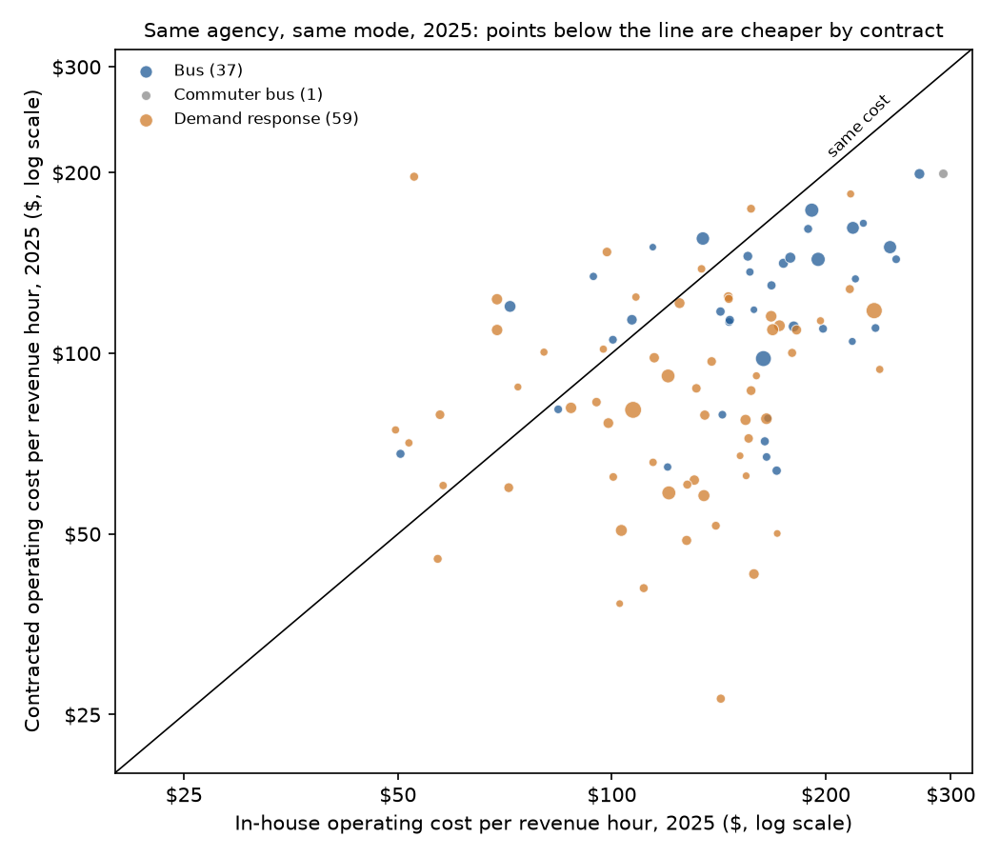
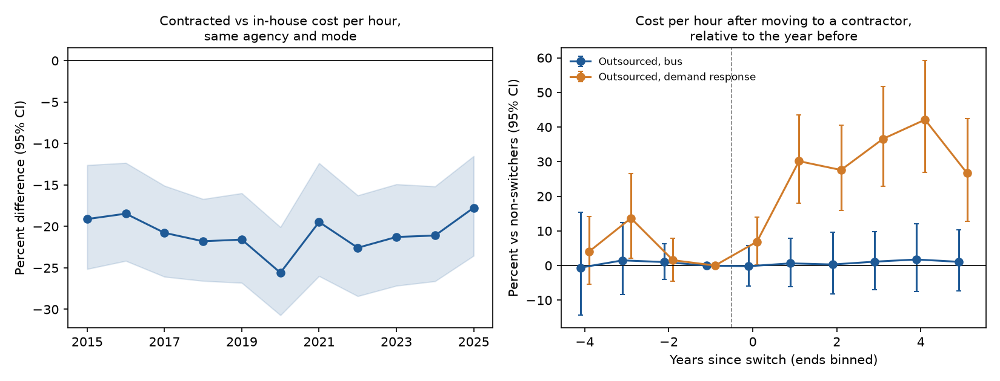

# Demsetz (1968) on American transit: findings

## In plain English

Harold Demsetz argued in 1968 that a service only one firm can efficiently supply need not be priced as a monopoly,
if firms bid for the right to supply it. American transit agencies do this every day with bus and paratransit
routes. This study compares contracted and in-house service in the National Transit Database, 2015 to 2025.

- **Contracted hours are cheaper inside the same agency.** Across 371 agency-modes that ran service both ways, a
  contracted hour cost 20.8% less than an in-house hour. Los Angeles Metro paid $150 an hour for bus service bought
  from operators led by MV Transportation and $246 for its own; San Diego MTS paid $98 for service led by Transdev
  and $163 for its own.
- **Bidding itself does not explain the gap.** Negotiated contracts were as cheap as competitively bid ones, and
  states with more contractor firms did not see lower contract costs. Three groups, Transdev (with First Transit),
  MV Transportation and Keolis, hold 56.6% of competitively bid contract dollars.
- **Switching to a contractor did not lower bus costs.** The 44 bus services that moved entirely to a contractor
  between 2017 and 2024 cost the same afterward, relative to agencies that did not switch. Paratransit services that
  switched became 20.3% more expensive and kept rising, the drift Oliver Williamson predicted, though many of those
  switches fell in the 2020 pandemic year.

A friendlier tour is in the [README](../README.md); methods are in [TECHNICAL.md](../TECHNICAL.md).

**Key to the labels below.** *DO* = directly operated (in-house). *PT* = purchased transportation (contracted).
*cph* = operating cost per vehicle revenue hour, 2025 dollars. *vrh* = vehicle revenue hours. *Agency-mode* = one
agency's fixed-route bus (MB, "Bus"), commuter bus (CB) or demand-response (DR) service. *coef_log* = regression
coefficient in log points; *pct_effect* or *pct* = 100(e^coef − 1). *pt_comp*, *pt_neg* = contracted service under
mostly competitively bid or mostly negotiated contracts. *lfirms* = log of the number of contractor groups holding
2025 contracts in the state. *Event time* = years since an agency-mode switched between in-house and contracted
operation; year −1 is the reference. Standard errors are clustered by agency except the cross-section and bidder
tests, which are clustered by state. The 50 state clusters in the bidder test are 48 states, the District of
Columbia and Puerto Rico.

### cost_tests.csv

| test | term | coef_log | se | p | pct_effect | pct_ci_low | pct_ci_high | n_obs | n_clusters | n_agency_modes |
|---|---|---|---|---|---|---|---|---|---|---|
| Panel 2015-25, all three modes | pt | -0.233 | 0.029 | 0.000 | -20.82 | -25.19 | -16.19 | 4,676 | 289 | 371 |
| Panel 2015-25, weighted by revenue hours | pt | -0.370 | 0.054 | 0.000 | -30.90 | -37.84 | -23.18 | 4,676 | 289 | 371 |
| Panel 2015-25, bus only | pt | -0.270 | 0.037 | 0.000 | -23.68 | -29.01 | -17.95 | 1,948 | 148 | 148 |
| Panel 2015-25, commuter bus only | pt | -0.177 | 0.075 | 0.018 | -16.19 | -27.64 | -2.92 | 209 | 18 | 18 |
| Panel 2015-25, demand response only | pt | -0.209 | 0.038 | 0.000 | -18.85 | -24.74 | -12.49 | 2,519 | 205 | 205 |
| 2025, competitively bid contract | pt_comp | -0.337 | 0.071 | 0.000 | -28.61 | -37.93 | -17.88 | 184 | 79 | 92 |
| 2025, negotiated or other contract | pt_neg | -0.407 | 0.264 | 0.123 | -33.46 | -60.33 | 11.61 | 184 | 79 | 92 |
| 2025 cross-section, competitively bid | pt_comp | -0.113 | 0.042 | 0.008 | -10.67 | -17.79 | -2.93 | 2,714 | 56 | 2,622 |
| 2025 cross-section, negotiated or other | pt_neg | -0.130 | 0.078 | 0.093 | -12.23 | -24.62 | 2.20 | 2,714 | 56 | 2,622 |
| Competitively bid cost on log contractor groups in state | lfirms | 0.048 | 0.032 | 0.129 | 4.89 | -1.38 | 11.56 | 611 | 50 | 611 |
| Same, mode effects only | lfirms | 0.047 | 0.027 | 0.081 | 4.86 | -0.59 | 10.61 | 611 | 50 | 611 |

### cost_by_service_2025.csv

| mode | service | agency_modes | median_cost_per_hour | hours | dollars | pooled_cost_per_hour |
|---|---|---|---|---|---|---|
| Commuter bus | Competitively bid | 51 | 193.66 | 1,039,150 | 237,090,979 | 228.16 |
| Commuter bus | In-house | 67 | 167.54 | 2,052,548 | 502,976,842 | 245.05 |
| Commuter bus | Negotiated or other | 4 | 135.10 | 73,990 | 26,552,907 | 358.87 |
| Demand response | Competitively bid | 305 | 106.18 | 37,325,933 | 4,127,745,881 | 110.59 |
| Demand response | In-house | 1,239 | 73.72 | 30,061,366 | 2,725,529,282 | 90.67 |
| Demand response | Negotiated or other | 32 | 78.63 | 1,774,933 | 206,936,881 | 116.59 |
| Bus | Competitively bid | 255 | 118.28 | 28,433,295 | 4,284,926,343 | 150.70 |
| Bus | In-house | 742 | 113.03 | 102,473,874 | 18,960,192,215 | 185.02 |
| Bus | Negotiated or other | 19 | 123.16 | 3,367,668 | 498,899,769 | 148.14 |

### agencies_both_summary.csv

| mode | agency_modes | contract_cheaper | median_gap_pct |
|---|---|---|---|
| Bus | 37 | 30 | -25.45 |
| Commuter bus | 1 | 1 | -31.62 |
| Demand response | 59 | 45 | -35 |
| All | 97 | 76 | -27.14 |

### agencies_both_2025.csv

| agency_name | state | mode | cph_DO | cph_PT | vrh_DO | vrh_PT | contractor | contract_type | contract_vs_inhouse_pct |
|---|---|---|---|---|---|---|---|---|---|
| Los Angeles County Metropolitan Transportation Authority | CA | Bus | 246.35 | 150.22 | 6,382,913 | 416,806 | MV Transportation | Competitively bid | -39.02 |
| New Jersey Transit Corporation | NJ | Bus | 218.42 | 161.76 | 5,664,469 | 357,745 | Academy Lines | Competitively bid | -25.94 |
| Southeastern Pennsylvania Transportation Authority | PA | Bus | 220.20 | 133.01 | 3,569,039 | 7,825 | Krapfs Cps | Competitively bid | -39.60 |
| King County | WA | Bus | 270.98 | 198.97 | 3,042,075 | 112,614 | Hopelink | Competitively bid | -26.57 |
| Metropolitan Transit Authority of Harris County, Texas | TX | Bus | 195.15 | 143.35 | 2,445,280 | 621,030 | Transdev (incl. First Transit) | Competitively bid | -26.54 |
| Pace, the Suburban Bus Division of the Regional Transportation Authority | IL | Bus | 155.38 | 145.08 | 1,648,043 | 59,933 | MV Transportation | Competitively bid | -6.63 |
| Utah Transit Authority | UT | Bus | 146.23 | 112.73 | 1,405,689 | 19,380 | MV Transportation | Competitively bid | -22.91 |
| Santa Clara Valley Transportation Authority | CA | Bus | 251.30 | 143.40 | 1,336,635 | 17,968 | El Paseo Limo | Competitively bid | -42.93 |
| Broward County Board of County Commissioners | FL | Bus | 165.11 | 67.18 | 1,189,727 | 16,477 | Limousines Of South Florida | Competitively bid | -59.31 |
| Orange County Transportation Authority | CA | Bus | 191.16 | 173.12 | 912,719 | 593,101 | Keolis | Competitively bid | -9.44 |
| San Diego Metropolitan Transit System | CA | Bus | 163.42 | 97.97 | 793,760 | 1,102,639 | Transdev (incl. First Transit) | Competitively bid | -40.05 |
| Pinellas Suncoast Transit Authority | FL | Bus | 142.20 | 117.35 | 605,732 | 40,355 | Jolley Trolley | Competitively bid | -17.48 |
| Omnitrans | CA | Bus | 146.56 | 113.59 | 528,207 | 38,360 | Transdev (incl. First Transit) | Competitively bid | -22.50 |
| Fort Worth Transportation Authority | TX | Bus | 156.43 | 136.57 | 459,996 | 12,183 | Echo Afc Transportation | Competitively bid | -12.70 |
| Delaware Transit Corporation | DE | Bus | 174.39 | 141.21 | 427,227 | 75,457 | Transdev (incl. First Transit) | Competitively bid | -19.02 |
| Delaware Transit Corporation | DE | Demand response | 157 | 174.08 | 395,102 | 24,579 | Transdev (incl. First Transit) | Competitively bid | 10.88 |
| City of El Paso | TX | Bus | 170.61 | 63.74 | 353,097 | 40,006 | Lulac Project Amistad | Competitively bid | -62.64 |
| Riverside Transit Agency | CA | Bus | 180.31 | 110.81 | 342,826 | 137,424 | Empire Transportation | Competitively bid | -38.54 |
| Lehigh and Northampton Transportation Authority | PA | Bus | 158.48 | 118.15 | 278,360 | 2,301 | Transdev (incl. First Transit) | Competitively bid | -25.45 |
| High Valley Transit District | UT | Bus | 84.05 | 80.64 | 275,777 | 20,231 |  |  | -4.06 |

### bidders_bins.csv

| firm_bin | agency_modes | states | median_cost_per_hour | mean_log_cost_vs_mode |
|---|---|---|---|---|
| 1-3 | 36 | 16 | 107.72 | -0.012 |
| 4-8 | 63 | 13 | 109.45 | -0.063 |
| 9-20 | 165 | 14 | 112.74 | -0.048 |
| 21+ | 347 | 7 | 118.67 | 0.035 |

### contractor_shares_2025.csv

| group | contract_dollars | contracts | agencies | share_pct |
|---|---|---|---|---|
| Transdev (incl. First Transit) | 3,053,502,136 | 173 | 104 | 34.84 |
| MV Transportation | 1,149,878,677 | 122 | 78 | 13.12 |
| Keolis | 759,669,831 | 16 | 8 | 8.67 |
| National Express | 341,641,246 | 21 | 13 | 3.90 |
| RATP Dev | 319,514,941 | 36 | 21 | 3.65 |
| Liberty Lines Transit | 179,123,252 | 1 | 1 | 2.04 |
| Easton Coach | 167,279,286 | 7 | 5 | 1.91 |
| Wedriveu | 164,079,920 | 5 | 3 | 1.87 |
| MTM Transit | 154,983,192 | 23 | 13 | 1.77 |
| New York Paratransit Group Gvc Mag | 152,175,651 | 1 | 1 | 1.74 |
| Via (incl. River North Transit) | 119,583,116 | 30 | 29 | 1.36 |
| Tucson Transit Management | 100,268,746 | 2 | 1 | 1.14 |
| Veterans Transportation Services | 96,600,065 | 1 | 1 | 1.10 |
| Professional Transportation Ptc Pta | 81,546,707 | 1 | 1 | 0.93 |
| Suffolk Bus | 79,400,528 | 2 | 1 | 0.91 |

### contract_market_summary.csv

| national_hhi_competitive_dollars | contractor_groups | competitive_contracts | competitive_dollars | all_contracts | negotiated_or_other_contracts | top3_share_pct | agency_modes_purchased | agency_modes_competitive | agency_modes_negotiated |
|---|---|---|---|---|---|---|---|---|---|
| 1,520.30 | 315 | 854 | 8,765,599,903 | 1,085 | 231 | 56.62 | 755 | 666 | 89 |

### gap_by_year.csv

| year | coef_log | se | pct_gap | pct_ci_low | pct_ci_high | contracted_rows |
|---|---|---|---|---|---|---|
| 2015 | -0.212 | 0.040 | -19.11 | -25.14 | -12.60 | 149 |
| 2016 | -0.204 | 0.037 | -18.46 | -24.16 | -12.33 | 161 |
| 2017 | -0.233 | 0.035 | -20.77 | -26.07 | -15.09 | 177 |
| 2018 | -0.246 | 0.032 | -21.79 | -26.57 | -16.69 | 190 |
| 2019 | -0.243 | 0.035 | -21.58 | -26.81 | -15.99 | 203 |
| 2020 | -0.295 | 0.036 | -25.59 | -30.71 | -20.08 | 215 |
| 2021 | -0.216 | 0.043 | -19.46 | -25.99 | -12.36 | 206 |
| 2022 | -0.256 | 0.040 | -22.57 | -28.41 | -16.26 | 208 |
| 2023 | -0.239 | 0.040 | -21.27 | -27.16 | -14.91 | 205 |
| 2024 | -0.237 | 0.037 | -21.10 | -26.61 | -15.17 | 200 |
| 2025 | -0.195 | 0.037 | -17.74 | -23.54 | -11.51 | 224 |

### gap_trend.csv

| test | coef_log | se | ci_low | ci_high | p | gap_2015_log | n_obs | n_clusters |
|---|---|---|---|---|---|---|---|---|
| Change in contracted-vs-in-house gap per year, 2015-2025 | -0.0003 | 0.0043 | -0.0087 | 0.0081 | 0.942 | -0.232 | 4,676 | 289 |

### williamson_tests.csv

| group | contrast | coef_log | se | p | pct | switchers | n_obs | n_clusters |
|---|---|---|---|---|---|---|---|---|
| Outsourced, all modes | after minus before (years 0..+5 vs -4..-2) | 0.093 | 0.031 | 0.003 | 9.72 | 91 | 883 | 74 |
| Outsourced, all modes | first two years after vs year -1 | 0.078 | 0.021 | 0.000 | 8.14 | 91 | 883 | 74 |
| Outsourced, all modes | years +3..+5 minus years 0..+1 (drift) | 0.065 | 0.028 | 0.018 | 6.73 | 91 | 883 | 74 |
| Outsourced, bus | after minus before (years 0..+5 vs -4..-2) | 0.0015 | 0.048 | 0.975 | 0.15 | 44 | 435 | 44 |
| Outsourced, bus | first two years after vs year -1 | 0.0022 | 0.029 | 0.940 | 0.22 | 44 | 435 | 44 |
| Outsourced, bus | years +3..+5 minus years 0..+1 (drift) | 0.011 | 0.028 | 0.697 | 1.10 | 44 | 435 | 44 |
| Outsourced, demand response | after minus before (years 0..+5 vs -4..-2) | 0.185 | 0.044 | 0.000 | 20.29 | 41 | 403 | 41 |
| Outsourced, demand response | first two years after vs year -1 | 0.165 | 0.032 | 0.000 | 17.95 | 41 | 403 | 41 |
| Outsourced, demand response | years +3..+5 minus years 0..+1 (drift) | 0.135 | 0.051 | 0.008 | 14.44 | 41 | 403 | 41 |
| Insourced, all modes | after minus before (years 0..+5 vs -4..-2) | 0.070 | 0.080 | 0.378 | 7.30 | 32 | 311 | 25 |
| Insourced, all modes | first two years after vs year -1 | 0.060 | 0.061 | 0.323 | 6.18 | 32 | 311 | 25 |
| Insourced, all modes | years +3..+5 minus years 0..+1 (drift) | 0.012 | 0.071 | 0.867 | 1.21 | 32 | 311 | 25 |

### event_study.csv

| group | event_time | coef_log | se | p | pct | pct_ci_low | pct_ci_high | switcher_rows |
|---|---|---|---|---|---|---|---|---|
| Outsourced, all modes | -4 | -0.0050 | 0.042 | 0.906 | -0.49 | -8.34 | 8.03 | 150 |
| Outsourced, all modes | -3 | 0.061 | 0.040 | 0.130 | 6.26 | -1.76 | 14.95 | 67 |
| Outsourced, all modes | -2 | 0.016 | 0.021 | 0.448 | 1.64 | -2.54 | 6.00 | 91 |
| Outsourced, all modes | -1 | 0.0000 | 0.0000 |  | 0.00 | 0 | 0 | 88 |
| Outsourced, all modes | 0 | 0.036 | 0.019 | 0.057 | 3.69 | -0.10 | 7.63 | 91 |
| Outsourced, all modes | 1 | 0.120 | 0.032 | 0.000 | 12.77 | 5.90 | 20.09 | 89 |
| Outsourced, all modes | 2 | 0.114 | 0.034 | 0.001 | 12.07 | 4.92 | 19.72 | 79 |
| Outsourced, all modes | 3 | 0.148 | 0.034 | 0.000 | 15.91 | 8.38 | 23.96 | 67 |
| Outsourced, all modes | 4 | 0.172 | 0.042 | 0.000 | 18.80 | 9.46 | 28.94 | 57 |
| Outsourced, all modes | 5 | 0.110 | 0.038 | 0.003 | 11.65 | 3.71 | 20.19 | 104 |
| Outsourced, bus | -4 | -0.0060 | 0.076 | 0.937 | -0.60 | -14.34 | 15.35 | 63 |
| Outsourced, bus | -3 | 0.015 | 0.052 | 0.776 | 1.50 | -8.37 | 12.43 | 28 |
| Outsourced, bus | -2 | 0.010 | 0.026 | 0.701 | 1.00 | -4.03 | 6.30 | 44 |
| Outsourced, bus | -1 | 0.0000 | 0.0000 |  | 0.00 | 0 | 0 | 42 |
| Outsourced, bus | 0 | -0.0019 | 0.030 | 0.948 | -0.19 | -5.85 | 5.80 | 44 |
| Outsourced, bus | 1 | 0.0063 | 0.035 | 0.857 | 0.64 | -6.06 | 7.80 | 44 |
| Outsourced, bus | 2 | 0.0031 | 0.045 | 0.946 | 0.31 | -8.18 | 9.57 | 41 |
| Outsourced, bus | 3 | 0.011 | 0.042 | 0.791 | 1.12 | -6.90 | 9.84 | 34 |
| Outsourced, bus | 4 | 0.017 | 0.049 | 0.722 | 1.76 | -7.54 | 11.98 | 29 |
| Outsourced, bus | 5 | 0.011 | 0.045 | 0.810 | 1.08 | -7.39 | 10.32 | 66 |
| Outsourced, demand response | -4 | 0.039 | 0.048 | 0.413 | 4.00 | -5.32 | 14.24 | 80 |
| Outsourced, demand response | -3 | 0.128 | 0.055 | 0.020 | 13.67 | 2.07 | 26.59 | 34 |
| Outsourced, demand response | -2 | 0.015 | 0.031 | 0.620 | 1.55 | -4.45 | 7.94 | 41 |
| Outsourced, demand response | -1 | 0.0000 | 0.0000 |  | 0.00 | 0 | 0 | 40 |
| Outsourced, demand response | 0 | 0.067 | 0.033 | 0.044 | 6.89 | 0.19 | 14.05 | 41 |
| Outsourced, demand response | 1 | 0.264 | 0.050 | 0.000 | 30.15 | 18.04 | 43.51 | 40 |
| Outsourced, demand response | 2 | 0.244 | 0.049 | 0.000 | 27.60 | 15.86 | 40.53 | 35 |
| Outsourced, demand response | 3 | 0.312 | 0.054 | 0.000 | 36.59 | 22.96 | 51.74 | 29 |
| Outsourced, demand response | 4 | 0.352 | 0.058 | 0.000 | 42.13 | 26.91 | 59.18 | 26 |
| Outsourced, demand response | 5 | 0.237 | 0.060 | 0.000 | 26.69 | 12.69 | 42.43 | 37 |
| Insourced, all modes | -4 | -0.050 | 0.098 | 0.608 | -4.92 | -21.57 | 15.27 | 67 |
| Insourced, all modes | -3 | 0.018 | 0.048 | 0.713 | 1.77 | -7.31 | 11.74 | 26 |
| Insourced, all modes | -2 | 0.037 | 0.046 | 0.421 | 3.74 | -5.13 | 13.44 | 28 |
| Insourced, all modes | -1 | 0.0000 | 0.0000 |  | 0.00 | 0 | 0 | 29 |
| Insourced, all modes | 0 | 0.037 | 0.060 | 0.537 | 3.76 | -7.71 | 16.66 | 32 |
| Insourced, all modes | 1 | 0.083 | 0.072 | 0.251 | 8.66 | -5.72 | 25.24 | 31 |
| Insourced, all modes | 2 | 0.095 | 0.102 | 0.354 | 9.91 | -10.01 | 34.25 | 26 |
| Insourced, all modes | 3 | 0.076 | 0.097 | 0.431 | 7.91 | -10.72 | 30.44 | 23 |
| Insourced, all modes | 4 | 0.109 | 0.109 | 0.317 | 11.53 | -9.92 | 38.09 | 17 |
| Insourced, all modes | 5 | 0.031 | 0.129 | 0.812 | 3.12 | -19.94 | 32.81 | 32 |

### switcher_names.csv

| agency_name | state | mode | direction | switch_year | cost_per_hour_before | cost_per_hour_after | hours_after | change_pct |
|---|---|---|---|---|---|---|---|---|
| Milwaukee County | WI | Bus | outsourced | 2018 | 132.68 | 129.30 | 1,301,949.50 | -2.54 |
| City of Charlotte North Carolina | NC | Bus | outsourced | 2019 | 146.97 | 156.36 | 760,643 | 6.39 |
| City of Tucson | AZ | Bus | outsourced | 2019 | 110.37 | 109.78 | 686,149 | -0.53 |
| New Orleans Regional Transit Authority | LA | Bus | insourced | 2021 | 185.26 | 164.05 | 471,716 | -11.45 |
| City of Raleigh | NC | Bus | outsourced | 2020 | 151.44 | 121.04 | 308,428.50 | -20.08 |
| City of Tucson | AZ | Demand response | outsourced | 2019 | 71.10 | 82.32 | 245,902 | 15.79 |
| Southwest Georgia RC | GA | Demand response | outsourced | 2020 | 47.45 | 54.15 | 126,881 | 14.11 |
| Escambia County Board of County Commissioners, FL | FL | Bus | insourced | 2018 | 142.86 | 114.38 | 108,339 | -19.94 |
| Valley Regional Transit | ID | Bus | outsourced | 2018 | 131.55 | 130.73 | 104,953.50 | -0.63 |
| New Orleans Regional Transit Authority | LA | Demand response | insourced | 2021 | 166.67 | 183.28 | 100,038 | 9.97 |
| Connecticut Department of Transportation- CTTransit Waterbury- NET | CT | Bus | insourced | 2022 | 176.96 | 174.04 | 99,706.50 | -1.65 |
| City of Asheville | NC | Bus | outsourced | 2019 | 94.66 | 113.03 | 86,314 | 19.41 |
| Metropolitan Tulsa Transit Authority | OK | Demand response | insourced | 2024 | 127.36 | 105.74 | 66,796.50 | -16.97 |
| Central Florida Regional Planning Council | FL | Demand response | insourced | 2020 | 52.66 | 55.19 | 64,779 | 4.81 |
| Southwest Ohio Regional Transit Authority | OH | Demand response | insourced | 2020 | 107.50 | 147.40 | 59,214.50 | 37.11 |

### sample_counts.csv

| step | rows |
|---|---|
| Time Series 2.1 agency-mode-service-years, 2015-2025 | 41,009 |
| bus, commuter bus, demand response; directly operated or purchased | 36,697 |
| positive expense and at least 2000 revenue hours | 32,398 |
| after trimming cost per hour at 1st/99th percentile by mode | 31,746 |
| 2025 contracts, all modes and positions | 1,781 |
| 2025 bus, commuter bus, demand response contracts bought by the reporter | 1,085 |

### bidding_formula.csv

| bidders | expected_price_above_best_cost_share_of_range |
|---|---|
| 1 |  |
| 2 | 0.667 |
| 3 | 0.500 |
| 5 | 0.333 |
| 10 | 0.182 |
| 20 | 0.095 |

### paper_benchmark_1902.csv

| cities_over_4000 | cities_with_telephone | independent_monopoly | bell_monopoly | duplicated_service | duplicated_share_pct |
|---|---|---|---|---|---|
| 1,051 | 1,002 | 137 | 414 | 451 | 45 |

The agency and switcher tables above show the first rows only. The complete files are `agencies_both_2025.csv`
(97 agency-modes), `switchers.csv` (123 switches) and `switcher_names.csv` (the 120 with cost data on both sides of the switch), and `panel_cost_per_hour.csv`
(31,746 rows).

## Figures

